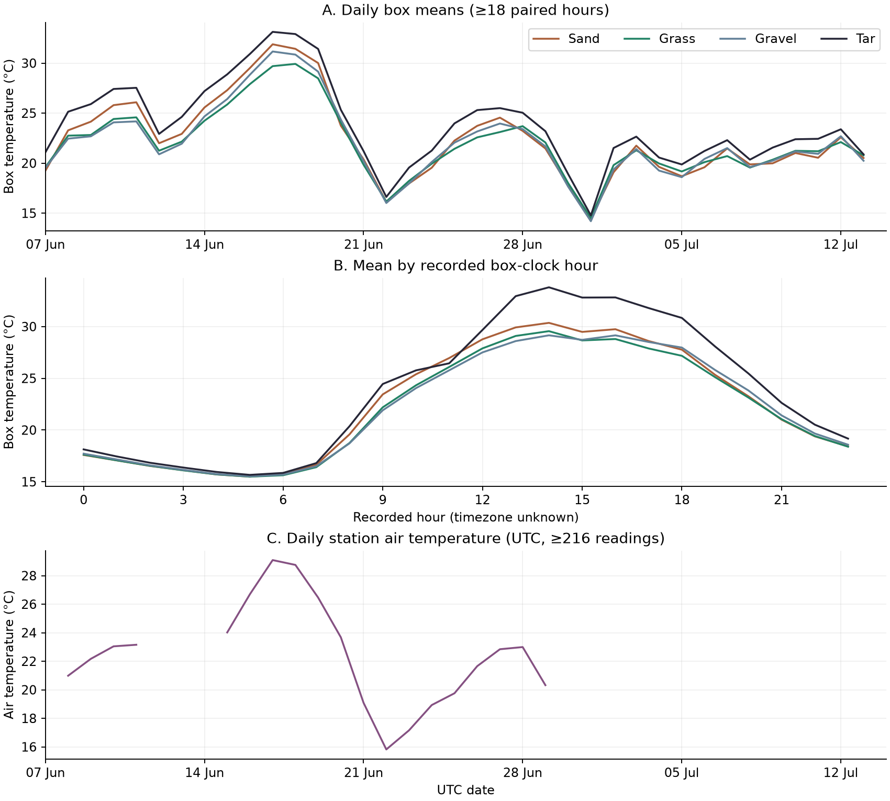

# Cologne Urban Climate Observatory

A reproducible analysis of the University of Cologne’s Cool City Lab. **How did temperatures inside boxes beneath tar, sand, grass and gravel differ during the same measurement hours?** These are box temperatures, not surface or outdoor air temperatures.

## Findings

From 7 June to 13 July 2021, **886 of 888** recorded-clock hours had at least 10 readings for each of the four boxes. The tar box was warmer on average than all three comparison boxes.

| Paired comparison | Mean difference | Median difference |
|---|---:|---:|
| Tar − sand | +1.34 °C | +0.73 °C |
| Tar − grass | +1.77 °C | +1.04 °C |
| Tar − gravel | +1.67 °C | +1.06 °C |

Requiring at least 12 readings in every box retained 884 hours; no mean difference changed by more than 0.002 °C. These are descriptive contrasts from one box per covering. Repeated hours are not independent experimental replicates, and box position, irrigation and other conditions can influence the contrast. The results do not estimate a city-wide cooling effect.



[Machine-readable aggregate results](docs/summary.json).

## Get the inputs

Open the [University of Cologne Cool City Lab page](https://geographie.uni-koeln.de/en/forschung/arbeitsgruppen/hydrogeographie-und-klimatologie/projektuebersicht/projekte/projektseiten/pulchra/the-cool-city-lab) and scroll to **Data from the Cool City Lab**. Download:

- **Weather data from the Cool City Lab:** `meteo_CoolCityLab.csv`.
- **Temperatures in the boxes:** `Cool_City_Lab_Temperaturen_Boxen.xlsx`.

Put both under the ignored `data/` directory, or supply their paths on the command line. The repository does not redistribute the files. The original workbook’s Notes sheet contains the experimental phase history in a text box.

## Reproduce

Use Python 3.11 or later, from the repository root:

```bash
python -m venv .venv
source .venv/bin/activate
python -m pip install -r requirements.txt
python analyze.py
python -m unittest discover -s tests -v
```

With files elsewhere, use `python analyze.py --boxes /path/to/temperatures.xlsx --weather /path/to/weather.csv`. The analysis writes `outputs/summary.json` and `outputs/overview.png`. The JSON records valid hours, full-workbook quality counts and sensitivity to the hourly coverage threshold. The figure shows daily paired means, the recorded-clock hourly cycle and a separate weather panel.

## Analysis choices

- **Sensors:** sand 15, grass 16, gravel 18 and tar 19, as documented on 27 May 2021 in the experiment log.
- **Window:** start 7 June, after grass was returned on 6 June; end before the 14 July storm and later lawn desiccation and setup changes. The analysis does not combine this period with phases when sensors shared a box or coverings were removed.
- **Pairing:** invalid values are excluded; duplicate valid readings at the same sensor timestamp are averaged before counting. Hourly means use each sensor’s own samples within the hour; a bin is included only when all four sensors meet the coverage threshold. No interpolation is used. Daily box means shown in the figure require at least 18 paired hours.
- **Time:** weather timestamps use UTC interval ends. The workbook provides unzoned timestamps, so the box series are compared on their recorded clock. Weather is summarised separately over the corresponding UTC calendar dates; no timestamp join or weather attribution is attempted. The weather panel shows daily means only for days with at least 216 readings (75% of a five-minute schedule).

Data and experimental design: University of Cologne Institute of Geography, Cool City Lab / PULCHRA. The MIT licence applies to the analysis code.
